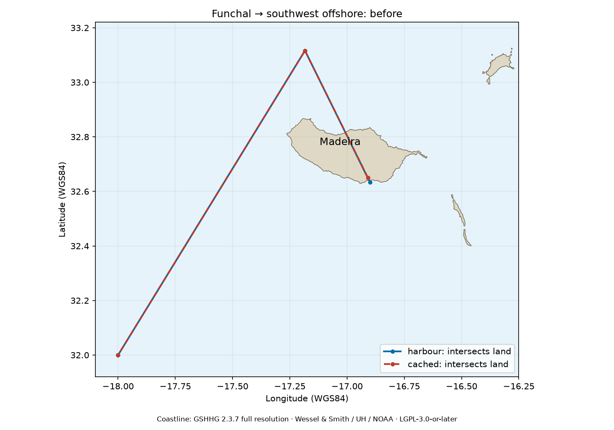
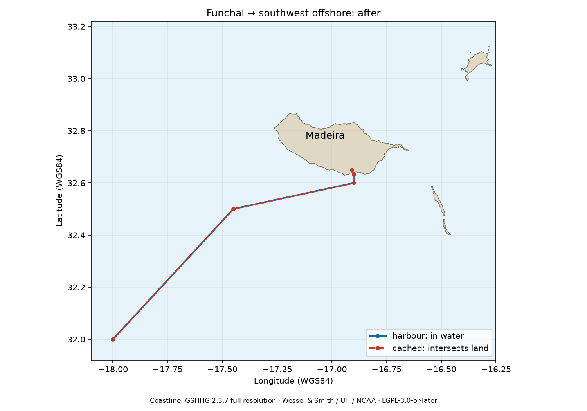

# Funchal / Madeira network correction

Investigated upstream main `4446009a4ce0c79bcf67616c05f28820fbdc7e08`
on 2026-10-12. No existing Madeira/Funchal issue or PR was found in GitHub
search or the repository's PR list. PR #56 adjusted other network areas.

## Reproduction and cause

```python
import searoute as sr
sr.searoute([-16.9086783, 32.6496497], [-18., 32.], append_orig_dest=True)
sr.searoute([-16.9086783, 32.6496497], [-18., 32.], append_orig_dest=False)
```

The cached coordinate snaps 57.893 km to `[-17.183808, 33.116222]`, north
of Madeira. With appended endpoints, the connector crosses the island.
Without appended endpoints, both endpoints snap to that same node and the
result has one coordinate and zero length.

There are two distinct causes: the cached coordinate is inland, and the
maritime network lacks Funchal/south-coast coverage. Correcting only the input
still reproduces the upstream defect: the harbour coordinate below snaps
north and crosses Madeira too. No nearby existing network edge intersects
the selected full-resolution coastline polygons.

## Coordinate and coastline sources

[Marina do Funchal](https://www.marinadofunchal.pt/islandmadeira/tarifario-marina-do-funchal/)
publishes 32°38′3″N, 16°54′2″W in its contact information. Converted and rounded
to the graph's six decimal places, this is `[-16.900556, 32.634167]`.
[APRAM's port plan](https://apram.pt/storage/578/PRGR-PORTO-DO-FUNCHAL.pdf),
section 2.1, independently places the port on Madeira's south coast and
identifies Marina do Funchal as part of the port. The coordinates on page 31
of that document describe a dredged-material disposal site, not the harbour,
and were not used as the harbour coordinate. No chart imagery is reproduced.

Land checks use GSHHG 2.3.7 full-resolution level-1 polygons, including Madeira,
Porto Santo, Desertas and surrounding islets. The fixture retains all vertices
and does not use the application's simplified coastline or 5 km exemption.
See [fixture attribution and licenses](../../searoute/tests/fixtures/README.md).
GSHHG is suitable for this island-scale defect; it is not a contemporary
survey of every harbour structure. Offshore waypoints were chosen for clear
water connections and verified against these full segment geometries; they
are network construction coordinates, not surveyed navigation waypoints.

## Change

Four nodes and six undirected edges add a harbour approach south to
`[-16.9, 32.6]`, southwest via `[-17.45, 32.5]` to the existing `[-20, 30]`
node, east to `[-16.31887, 32.773089]`, and west of Madeira via
`[-17.45, 32.9]` to `[-17.183808, 33.116222]`.

Both `marnet_searoute.geojson` and the runtime `marnet_dict.py` are updated.
The source and runtime already differ elsewhere (9701 versus 9708 nodes);
`tools/update_madeira_network.py` uses the existing GeoJSON loader and
`to_nodes_edges_set` exporter to apply only the Madeira additions. All
existing nodes, edges, weights and passage metadata are preserved. New
weights follow the existing rounded-kilometre convention, and adjacency
entries are present in both directions.

## Evidence




Blue is the verified harbour input; dashed red is the original cached input.
The valid harbour route changes from 205.569 km with an island crossing to
132.472 km wholly in water. The inland cached input still has a short land
connector after the network correction. Users of that coordinate should
correct their input independently; this PR does not make arbitrary inland
inputs safe to append.

The eight GeoJSON files preserve before/after results for both inputs with
and without appended endpoints. `summary.json` records coastline checks,
snapped nodes and distances.

## Regeneration

From the checkout root, with package dependencies plus `shapely`, `matplotlib`,
`pytest` and `build` installed:

```sh
rtk proxy curl -L --fail https://www.soest.hawaii.edu/pwessel/gshhg/gshhg-bin-2.3.7.zip -o /tmp/gshhg-bin-2.3.7.zip
rtk proxy sh -c 'git show 4446009a4ce0c79bcf67616c05f28820fbdc7e08:searoute/data/marnet_dict.py > /tmp/madeira-baseline-runtime.py'
rtk proxy python tools/update_madeira_network.py
rtk proxy env MPLCONFIGDIR=/tmp/searoute-mpl python tools/madeira_evidence.py --coastline-archive /tmp/gshhg-bin-2.3.7.zip --baseline-runtime /tmp/madeira-baseline-runtime.py
rtk proxy pytest -q
rtk proxy python -m build
```

The evidence script uses the public API with the baseline graph for before,
and the normal default packaged network for after. The baseline file can
also be exported with `git --git-dir=/tmp/searoute-upstream.git show ...`
when using this task's external Git metadata.

## Validation

- New regressions on unmodified upstream graph: **37 failed**.
- Corrected full suite: **55 passed** on Python 3.14.
- Coverage: valid harbour and two nearby water origins, southwest/north/east
  destinations, reverse journeys, appended and unappended endpoints, complete
  segment coastline intersections, symmetric weighted edges and source/runtime
  consistency.
- Graph components: **1 before, 1 after**; all existing graph attributes preserved.
- Wheel and source distribution build successfully.
- Fresh wheel installation, isolated from this checkout: corrected default
  public API route verified, and **55 full-suite tests passed** (including
  all 37 Madeira regressions) using `python -I -m pytest --pyargs searoute.tests`.

This work changes only this upstream checkout and its fork branch.
